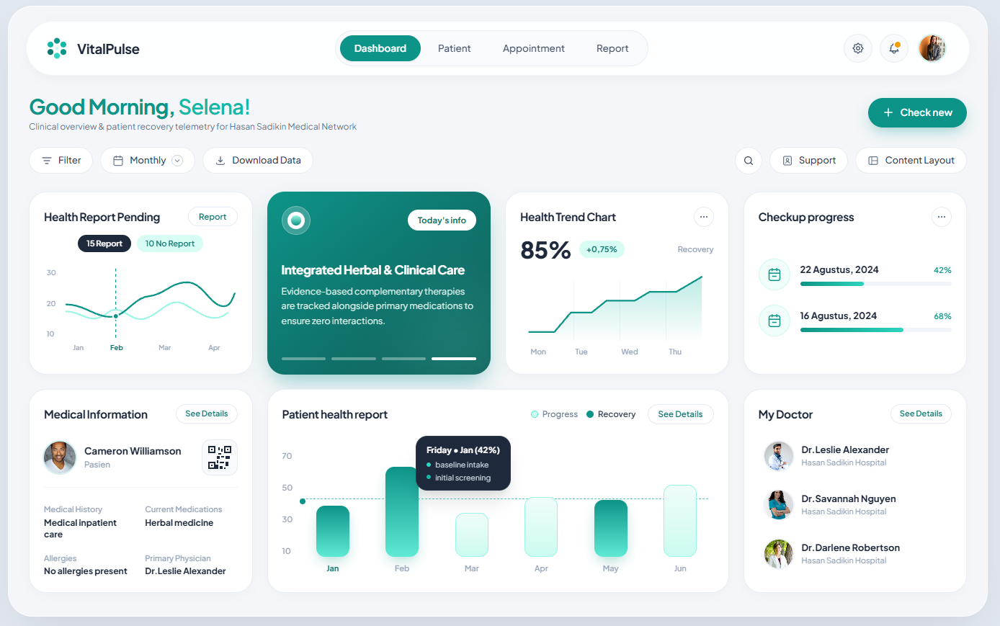

# VitalPulse Healthcare Intelligence Dashboard

A responsive, frontend-only dashboard template for exploring patient records, appointments, and clinical reports. No account, server, or API key is needed to use the demo.

[**Open the live demo**](https://laluarifta.github.io/vitalpulse_healthcare_intelligence_dashboard/) · [Use this template](https://github.com/LALUARIFTA/vitalpulse_healthcare_intelligence_dashboard/generate)

## Design preview



## What you can try

- Explore dashboard charts, checkup milestones, filters, and layout controls.
- Add, edit, search, and remove sample patients, appointments, and reports.
- Download sample patient records as CSV. Use **Settings → Reset Data** to restore the sample records.

> Demo only. The clinic, records, and clinical actions are fictional. Changes stay in your browser's local storage; there is no backend, authentication, or clinical integration. Do not enter real patient information.

## Run locally

Use Node.js 24 LTS and npm.

```sh
cd frontend
npm ci
npm run dev
```

To build and preview the production site:

```sh
npm run build
npm run preview
```

## Project structure

```text
.github/workflows/pages.yml  GitHub Pages build and deployment
frontend/
├── index.html               Dashboard markup and views
├── public/avatars/          Bundled demo portraits and fallback avatar
├── src/
│   ├── app.js               Navigation, rendering, and interactions
│   ├── data/demo.js          Fictional records and default state
│   └── styles/dashboard.css Custom dashboard styles and Tailwind entry
├── tailwind.config.js        Design tokens and Tailwind source paths
└── vite.config.js            Production build with relative asset URLs
docs/images/                 README design preview
```

Customize the markup in `frontend/index.html`, the palette in `frontend/tailwind.config.js`, and the sample records in `frontend/src/data/demo.js`. The interface uses vanilla JavaScript, Tailwind CSS, and the bundled Plus Jakarta Sans font.

## Deploy your copy

1. Create a repository from this template and push to `main`.
2. In **Settings → Pages**, select **GitHub Actions** as the source.
3. Run **Deploy GitHub Pages** from the **Actions** tab. Future pushes to `main` deploy automatically. Update the README links for your copy.

For another static host, publish the contents of `frontend/dist` after running `npm run build`.

Demo portraits are from [Unsplash](https://unsplash.com/license) and do not depict the people named in the fictional records. The image above is the supplied design reference, not a screenshot of the deployed demo.
